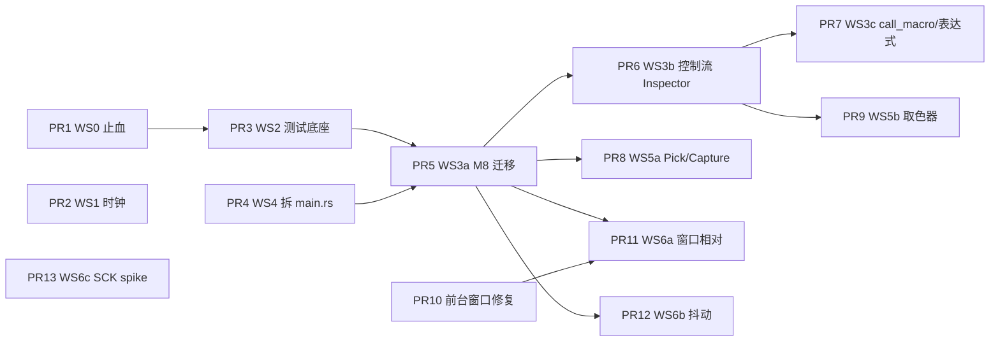

# tap - 编辑器与引擎加固 Proposal

> 状态：Draft（待评审）。时间点提案，落地后以代码与 `specs/features/` 为准。
> 来源：对 tap 现状的外部评审（argo）+ 本次逐条代码核实。核实时的代码基线：`main` @ `036afa6`，macOS 26.5.1。

## 1. 结论

评审方向基本成立，**可以按此方向推进**，但需要三处修正：

1. **优先级重排**：评审把数据丢失放在第 1 条是对的，但它实际是**静默数据丢失**，应当先于一切功能工作单独热修；ScreenCaptureKit 迁移**不是当前缺陷**（实测仍可用），应降为风险预案。
2. **补充一个评审没有指出的根因**：`Profile` 投影是所有“新增文档字段”的陷阱（见 §2.1）。抖动、窗口相对坐标都要新增文档字段，因此 **M8（前端直接编辑 `MacroDocument`）必须先于它们**。
3. **两处需要产品决策**：`WaitUntil` / `call_macro` 之后是否“追赶”（§4.2）、窗口相对坐标放在文档级还是动作级（§4.6）。

## 2. 评审逐条核实

| # | 评审结论 | 核实结果 | 备注 |
|---|----------|----------|------|
| 1a | `call_macro` / 表达式宏被有损编辑 | **属实，严重** | 已复现，见 §2.1 |
| 1b | Inspector 看不到控制流/条件动作 | **属实**，体验缺口 | 数据不丢（见下） |
| 2a | 暂停 / 失焦 / `WaitUntil` 后爆发追赶 | **部分属实** | 暂停与失焦是缺陷；`WaitUntil` 属语义取舍，见 §2.2 |
| 2b | 抖动 | 合理 | 已在 backlog；依赖 M8 |
| 3a | 窗口相对坐标 | 合理 | 已在 backlog；有评审未提的前置缺陷，见 §2.3 |
| 3b | 迁移 ScreenCaptureKit | **时机不对** | 实测当前可用，见 §2.4 |
| 4a | Inspector 内 Pick / Capture | 合理 | 需要“请求式拾取”，否则会覆盖 Simple 模式坐标 |
| 4b | `pixel_color` 取色器 | 合理，**部分已有** | `ColorPickerCard` 已支持“取光标处颜色”；真正缺的是与条件编辑联动 |
| 5a | 拆分 `main.rs` | 合理 | 1391 行属实；评审提到的“托盘”并不存在 |
| 5b | 前端 store 单测 | 合理 | `package.json` 无任何测试框架；已在 backlog |

评审中的小出入：`capture_Next_key` 实际命令名为 `cmd_capture_key`；`ui-design.md` 写 Inspector “编辑选中动作的全部参数”，与现状不符（规范漂移，落地时一并更正）。

### 2.1 有损编辑（1a）：证据与根因

**机制**：前端用 `editable = variables.length === 0` 判断能否可视化编辑（`src/stores/documentStore.ts:219`）。该判据是错误的代理：

- `document_to_profile_view` 用 `filter_map(... .ok())` 丢弃无法解析的步骤，`call_macro` 永远无法解析（`resolve.rs:186-205`）。
- 表达式在视图里被求值为字面量（仅用变量默认值作用域；引用计数器的表达式会解析失败而被丢弃）。
- 前端任何编辑（含仅改名，`setName` → `mutateMeta`）都会去抖推送 `update_profile` → `apply_profile_edit`，后者只保留 `variables`/元数据，**时间线整体被视图覆盖**（`session.rs:76-85`）。

**复现**（临时程序，未入库）：零 `variables` 的宏，6 步，含 2 个 `call_macro`（其中 1 个嵌在 `conditional.then_action`）、`x: '{{ 40 + 60 }}'`、`x: '{{ i * 10 }}'`。仅改名后：

- `profile_view` 只剩 3 步；`apply_profile_edit` 后**规范文档也只剩 3 步**，且 `'{{ 40 + 60 }}'` 被压平成 `100`；
- 含 `call_macro` 的 `conditional` 整体消失。

后续“保存”会把损坏的文档落盘。引擎运行读取的是规范文档，所以**未编辑时运行不受影响**，损坏发生在编辑推送之后。

**根因（比评审更深一层）**：`Profile` 无法表达文档的任意新增字段。`apply_profile_edit` 通过“手工挑选保留哪些字段”（variables / description / author / tags / version）来打补丁；每新增一个文档字段（抖动、窗口相对坐标……）都会被这座桥静默重置。1b 中 `WaitUntil` / 计数器 / `Exit` 能无损往返，仅因为 `Action` 恰好包含它们，不是设计保证。

### 2.2 回放时钟（2a）

`execute_timeline` 在每轮开头取一次 `Instant::now()`，用 `target_ms > start.elapsed()` 排程（`engine.rs:339-372`）。暂停（`Paused` 循环与 `interruptible_sleep`）和 `wait_for_target_window` 的阻塞时间都计入 `elapsed`，恢复后所有 `at_ms` 已过期的步骤**零间隔连发**。录制得到的时间线（如键入、拖拽序列）会被压成一瞬间。这是缺陷。

`WaitUntil`、`call_macro`（以及 `Wait`、`Drag`）耗时后的追赶则是**现有语义**，且被依赖：`templates/wait_for_color.yaml` 的 `click@100` 紧跟 `wait_until@0`，默认 profile 的 `Wait{500}@500` 与 `KeyTap@1200` 也按“绝对偏移、已过期则立即执行”设计。直接改它会改变存量宏的行为，所以把它单列为决策项 D1，本期默认**不改**，仅把语义写进规范。

### 2.3 窗口相对坐标（3a）的前置缺陷

`WindowRect::to_absolute` 确实未被任何调用方使用。但要让它可用，需要先修两处评审没有提到的问题：

- **macOS 前台窗口判定不可靠**：`get_foreground_window` 取“屏上列表里第一个 layer-0 窗口”（`window/macos.rs`），而不是“当前激活应用的主窗口”。实测（macOS 26.5.1）在 Cursor 为前台应用时，返回的是 `Google Chrome`、标题为空、1512×41 的窗口。仅一次观测，需先写最小复现再修。该函数同时被 `pause_when_unfocused`、`window_focused` 条件、Key→Click 窗口锁使用，所以这也是**现存的正确性风险**。
- **Windows 窗口矩形含不可见边框**：`GetWindowRect` 在 Win10/11 上包含约 7px 的不可见缩放边框；窗口相对坐标应使用 `DwmGetWindowAttribute(DWMWA_EXTENDED_FRAME_BOUNDS)`。

### 2.4 `CGWindowListCreateImage`（3b）

在 macOS 26.5.1、已授予屏幕录制的机器上，用 `tap-platform` 的 `get_pixel_color` 实测仍能返回合理像素（菜单栏 `#000000`、内容区 `#FFFFFF`）。因此这是**未来风险，不是当前缺陷**。另外 ScreenCaptureKit 是异步 API，单点轮询（`wait_until` 默认 100ms）的延迟与权限提示行为都要先验证，不宜直接替换。

## 3. 目标与非目标

**目标**

- 任何可视化编辑**不再静默丢数据**；最终所有 DSL 动作都能在 UI 中创建与编辑。
- 暂停 / 失焦不再引起爆发追赶。
- 为窗口相对坐标、抖动等“文档级新特性”铺好不丢字段的通路。
- 前端同步契约（去抖 + 启动/保存前 flush）有自动化测试守护。

**非目标**

- 不改 YAML DSL 的既有语法，存量宏文件无需迁移。
- 不引入多轨时间线、OCR、插件系统（沿用 backlog 的“明确非目标”）。
- 不把抖动定位为“规避检测”；它只是减小输入的机械规律性、缓解目标程序丢弃过密/过规整输入的兼容问题，默认关闭。

## 4. 方案

按工作流（WS）描述，PR 顺序见 §5。

### 4.1 WS0 - 止血：禁止有损编辑（热修，临时方案）

- `tap-application`：`SessionStore` 新增 `visual_edit_support() -> VisualEditSupport`，值为 `Full` 或 `ReadOnly(reason)`。判据为对 `DslAction` 树的结构遍历（递归进入 `then_action` / `else_action`）：存在 `CallMacro`、任一 `DslValue::String` 含 `{{`、或 `variables` 非空，即为只读，并带上原因。
- 纵深防御：`apply_profile_edit` 改为返回 `Result`，在 `ReadOnly` 时拒绝并返回错误，不再依赖前端自觉。
- IPC：新增 `get_edit_support`，前端 `editable` 改为读取后端结果，不再用 `variables.length === 0` 推断；顶部提示显示只读原因（“使用了 call_macro，请在 Code 视图编辑”）。6 处 `setVariables(await api.getMacroVariables())` 收敛为一个 `syncDocumentState()`。
- 测试：把 §2.1 的复现做成 `tap-application` 回归测试；再加不变量测试——对所有判为 `Full` 的夹具（含 `templates/`），`apply_profile_edit(profile_view())` 之后解析结果与原文档**语义等价**。
- 说明：本方案是**临时的**，WS3 完成后整体删除，不变量测试迁移到新的文档同步测试中。

验收：§2.1 的宏改名后仍为 6 步，且 UI 显示只读原因。

### 4.2 WS1 - 回放时钟：排除暂停与失焦时间

- 新增 `tap-application/src/clock.rs`：纯结构体 `StallAccounting`（接收注入的 `Duration` 作为“现在”，便于无 sleep 单测），提供 `pause(now)` / `resume(now)` / `exclude(d)` / `excluded(now)`。
- `Player` 持有一份运行级 `StallAccounting`：在 `transition_state` 进入/离开 `Paused` 时记账；`wait_for_target_window` 的阻塞时长也计入。这样**不需要逐个修补 `interruptible_sleep` 调用点**，暂停发生在任何 sleep 内部都被覆盖。
- `execute_timeline` 记录 `excluded_at_start`，排程时用 `wall_elapsed - (excluded_now - excluded_at_start)`。子宏（`call_macro`）各自快照，父级的暂停时间同样被排除。
- 规范：`dsl-reference.md` 中 `at_ms` 定义为“**活跃时间**时钟上的不早于（not-before）偏移，暂停与目标窗口失焦不计时；步骤超时则立即执行”。
- 测试：`StallAccounting` 单测；引擎集成测试扩展 `RecordingExecutor` 记录时间戳，暂停 400ms 后断言恢复后的步间距 ≥ 设计间距（宽松阈值避免 flaky）；失焦同理（`PlatformConditionProvider` 假实现切换焦点）。

**决策 D1**（本期默认不做）：`WaitUntil` / `call_macro` 耗时是否也从时钟中排除。若排除，则“条件满足后 N ms 再执行下一步”，混合录制时间线的步间距得以保留，但 `wait_for_color` 等模板的行为会有 ≤100ms 的变化。`Wait` 与 `Drag` 因自带时长且被默认 profile 依赖，不建议改。

### 4.3 WS2 - 前端测试底座与同步契约

- 增加 `vitest`（node 环境，store 不依赖 DOM）、`yarn test` 脚本；`tap-ci.yml` 的 `frontend` job 增加 `yarn test`。`vi.mock("../lib/ipc")` 隔离 Tauri。
- `documentStore` 用例：
  1. 去抖窗口内多次编辑合并为一次 `updateProfile`，且为最新内容；
  2. `flush()` 立即推送并等待 IPC 完成；有在途推送时等待其完成；
  3. 推送失败后 `needsPush` 保持，下一次 `flush()` 重试；
  4. `applyProfile` 取消待推送，不会出现加载后的“陈旧覆盖”；
  5. `editable === false` 时所有变更为 no-op 且无推送（WS0 回归）；
  6. 元数据 400ms 去抖，`flush()` 先推元数据再推时间线；
  7. 推送串行化（链在 `pushInFlight` 之后），避免并发 IPC 乱序——如测试暴露该问题则一并修复。
- `engineStore` 用例：每种 `EngineEvent` 的状态迁移、`Idle` 重置、日志上限 200、未知事件兜底、`guard()` 错误路径。
- `lib/run.ts`（启动前 flush）与 `lib/actions.ts` 的纯函数测试。
- 先于 WS3 落地，使 M8 重构有契约保护。

### 4.4 WS4 - 拆分 `src-tauri/src/main.rs`（纯搬移，先于 WS3）

仅移动代码、不改行为，便于 WS3 的 diff 可评审。目标布局：

```
src-tauri/src/
  main.rs              # 模块声明、日志初始化、builder、invoke_handler
  app.rs               # setup_app、紧急停止处理
  ports.rs             # EnigoExecutor、TauriPlatformProvider
  events.rs            # poll_events 事件泵、convert_input_event
  picker.rs            # 拾取窗口命令与生命周期
  state.rs             # AppState（含 dry_run、key_click_injector）与事件 DTO
  key_click.rs         # 现有按键连点运行器（未改动）
  templates.rs         # 现有模板加载（未改动）
  commands/
    engine.rs          # start/pause/resume/stop/emergency/get_state/dry_run
    document.rs        # profile 编辑/持久化/元数据/模板/文件导入导出/simple_repeat
    yaml.rs            # YAML 导入导出/校验/宏变量
    recording.rs
    key_click.rs       # 按键连点命令 + capture_key
    system.rs          # 权限、窗口、像素、鼠标追踪
```

- 同步清理（已完成）：删除仅写不读的 `AppState.executed_count` / `current_action_index`；`KEY_CLICK_INJECTOR` / `DRY_RUN` 两个全局 `OnceLock` 收进 `AppState`。顺带的唯一行为差异：连点注入器创建失败时命令返回错误，而不是在持有状态锁时 panic（panic 会毒化全局互斥锁）。
- 约束：每个模块 <300 行；新命令必须放入对应 `commands/` 子模块。
- 验证：`cargo clippy -p tap-tauri -- -D warnings`、`cargo test -p tap-tauri`（macOS CI）。

### 4.5 WS3 - M8：前端直接编辑 `MacroDocument` + 完整 Inspector

**为什么必须做**：它同时解决 1a（根治，WS0 随之删除）与 1b，并使 `call_macro`、表达式、计数器、条件都可编辑；也是 WS6 的前提（§2.1 根因）。

**WS3a - IPC 与 store 迁移（行为对等）**

- IPC：`get_document() -> MacroDocument`、`update_document(MacroDocument)`；`import_yaml` / `load_profile` / `apply_template` 返回文档。下线 `update_profile`、`get_current_profile`、`get_macro_variables`、`cmd_get/set_document_meta`、`apply_profile_edit`、`profile_view`。`update_document` 做校验但**不拒绝**编辑中间态，错误以告警返回并在 UI 内联显示。
- `serde_json` 对现有外部标签枚举（`DslAction` / `DslCondition`）与 `untagged` 的 `DslValue` 原生可用，**Rust 数据模型无需改动**。
- 前端：`documentStore` 持有 `doc: MacroDocument` 镜像；`editable` 概念消失；去抖 + flush 契约保持不变，WS2 的测试适配后继续守护。
- 类型对齐（**决策 D3**）：推荐“手写 TS 类型 + 黄金夹具契约测试”——Rust 测试把一份覆盖全部动作/条件变体的 `MacroDocument` 序列化为 `src/lib/__fixtures__/kitchen_sink.document.json`（`UPDATE_FIXTURES=1` 再生成，否则比对），vitest 读取并用 `satisfies MacroDocument` 校验，两侧漂移都会失败。不选 `ts-rs` 的原因：`u64` 默认映射为 `bigint`，需要逐字段覆盖，收益不抵摩擦。

**WS3b - Inspector：控制流与计数器**

- `lib/actions.ts` 改为按 `DslAction` 判别，使用 `assertNever` 保证**穷尽**；`ActionStarting` 事件载荷仍为解析后的 `Action`，`formatAction` 同样补全。
- 新动作：`WaitUntil`（条件 + 超时 + 轮询）、`Conditional`（条件 + then/else 嵌套动作）、`SetCounter` / `IncrCounter` / `DecrCounter` / `ResetCounter`、`Exit`。条件编辑器先支持叶子条件（`window_focused` / `window_exists` / `pixel_color` / `counter` / `always` / `never`）；`and` / `or` / `not` 先在 Code 视图编辑，并在 UI 中明确标注。
- “添加动作”菜单按类别分组：输入 / 时序 / 控制流 / 计数器 / 宏。

**WS3c - `call_macro` 与表达式**

- `ValueField`：同一输入框支持数字或 `{{ expr }}`，带变量下拉插入与括号配平检查（求值错误仍在运行时报告）。
- `call_macro`：宏名下拉（来自 `list_profiles`）+ `args` 键值表；检测自引用提示（引擎已有环路保护）。
- 变量定义小面板（名称 / 类型 / 默认值 / 描述）。

兼容：YAML 文件格式与存量宏不变；Code 视图与可视视图共享同一文档，切换不再丢数据。

### 4.6 WS5 - 编辑器体验

**WS5a - Inspector 内 Pick / Capture**

- 新增**请求式拾取**：`requestPosition(consumer)`；`position-picked` 事件先交给当前请求方，无请求时才回退到 Simple 模式。否则 Inspector 的拾取会覆盖 Simple 模式的 `clickX/Y`（当前事件处理写死在 `toolStore.setPickedPosition`）。
- Inspector：`Click` / `DoubleClick` / `MouseDown` / `MouseUp` / `MouseMove` 的 X/Y 旁加 Pick；`Drag` 提供 From / To 两个 Pick；`KeyTap` / `KeyDown` / `KeyUp` 加 Capture。字段当前为表达式时禁用 Pick 并提示。
- 后端：`cmd_capture_key` 为同步命令且最长阻塞 10s 轮询；按 Tauri 文档，同步命令在主线程执行，应改为 `#[tauri::command(async)]` + `spawn_blocking`（实现前先按文档核实）。

**WS5b - `pixel_color` 取色器**（依赖 WS3b）

- `open_picker_window(mode)` 支持 `position_color`；`picker_position_selected` 先**关闭覆盖窗口**、等待约一帧，再在注入坐标系采样并随事件返回 `{x, y, color}`。不能在覆盖窗口可见时采样：覆盖层是半透明遮罩，会污染颜色。
- `pixel_color` 条件编辑器提供“从屏幕拾取”，一次填入 x / y / `#RRGGBB`，容差保持默认。拾取过程中不做实时取色预览，只在点击后展示结果。
- 保留 `ColorPickerCard` 的“取光标处颜色”。

### 4.7 WS6 - 平台与引擎特性（均依赖 WS3）

**WS6a - 窗口相对坐标**（**决策 D2**）

- 推荐**文档级**开关而非 backlog 原设想的 `Action.relative_to_window`：`target_window.coordinates: screen | window`（默认 `screen`，非默认才序列化）。`Action` / `DslAction` 不变，同一开关同时覆盖所有带坐标的动作与 `pixel_color` 条件，避免逐动作标志位与混用带来的歧义。存量宏零影响。
- 引擎：`PlatformConditionProvider` 增加 `window_origin(title, process) -> Option<(i32, i32)>`，在**每个动作分发时**取原点并相加（窗口移动即时生效）；找不到窗口时复用“等待目标窗口”流程并发事件。原点解析优先“前台且匹配”的窗口，其次取匹配窗口中最大者。
- 录制：开启时在捕获事件时换算为相对坐标（点击时现取原点，移动事件用约 100ms 缓存）。拾取器同样按开关换算。UI：`TargetWindowCard` 增加“相对目标窗口”开关，仅在设置了目标窗口时可用。
- 前置修复（独立 PR，先行）：macOS 前台窗口改为“`NSWorkspace.frontmostApplication` 的 pid → 该 pid 的最大 layer-0 窗口”（需先给出最小复现）；Windows 改用 `DWMWA_EXTENDED_FRAME_BOUNDS`（`windows-sys` 增加 `Win32_Graphics_Dwm`）。
- 局限（写入规范）：仅平移，不随窗口缩放；最小化 / 屏外窗口视为不可用。
- 测试：原点换算与录制换算为纯单测；引擎集成测试用会在两轮之间移动的假 provider。

**WS6b - 随机抖动（Humanization）**

- `run.humanize: { position_px: u32, delay_ms: u32 }`（默认 0，全 0 时不序列化）。
- 位置抖动仅作用于原子动作（`Click` / `DoubleClick` / `MouseMove` / `Drag` 端点）；`MouseDown` / `MouseUp` 配对共用同一偏移，避免点击被抖成微小拖拽。延迟抖动只作用于排程间隔，且不会改变步骤顺序；不作用于显式 `Wait`。
- 种子可注入（运行级 RNG，测试固定种子），`apply_jitter(action, rng, cfg) -> Action` 为纯函数，单测覆盖边界。
- UI：`PlaybackCard` 增加“位置抖动 ±px / 延迟抖动 ±ms”。

**WS6c - ScreenCaptureKit（预案 / spike）**

- 触发条件：新 macOS / SDK 上编译或运行期取色失败，或 Apple 发布移除通知；否则仅保持监控。
- Spike 内容：在 `tap-platform/pixel` 引入 `PixelSampler` trait（Quartz 实现 + SCK 实现，运行期优先 Quartz，失败再回退 SCK）；评估 `objc2-screen-capture-kit`（纯绑定）与 `screencapturekit` crate（需确认是否引入 Swift 构建依赖）；指标：单点截取 p95 延迟需明显低于 100ms 轮询间隔，否则考虑低帧率 `SCStream` 缓存帧。CI 的 `macos-latest` 必须可构建。

## 5. 排期与依赖



| PR | 内容 | 规模 | 提交类型建议 |
|----|------|------|--------------|
| 1 | 禁止有损编辑（WS0） | S | `fix(tap)` |
| 2 | 回放时钟排除暂停/失焦（WS1） | S | `fix(tap)` |
| 3 | vitest + store 契约测试（WS2） | S | `test(tap)` |
| 4 | 拆分 `main.rs`（WS4，纯搬移） | M | `refactor(tap)` |
| 5 | 文档级 IPC 与 store（WS3a） | L | `refactor(tap)` |
| 6 | 控制流 / 计数器 Inspector（WS3b） | M | `feat(tap)` |
| 7 | `call_macro` / 表达式 / 变量面板（WS3c） | M | `feat(tap)` |
| 8 | Inspector Pick / Capture（WS5a） | S | `feat(tap)` |
| 9 | `pixel_color` 取色器（WS5b） | S | `feat(tap)` |
| 10 | 前台窗口判定修复（macOS；Windows 矩形并入 PR 11） | S | `fix(tap)` |
| 11 | 窗口相对坐标（WS6a） | L | `feat(tap)` |
| 12 | 随机抖动（WS6b） | M | `feat(tap)` |
| 13 | ScreenCaptureKit spike（WS6c） | S | `chore(tap)` |

PR 1、2、3、4 互不依赖，可并行。每个 PR 独立可发布、可回滚。

进度：PR 1–12 已实现；PR 13 待启动（按触发条件）。

PR 5 落地说明（与上文设计的差异）：
- WS0 的临时止血层（`edit_support`、`apply_profile_edit` 的拒绝逻辑、`get_edit_support`、前端 `editable`）与 `profile_view` / `document_to_profile_view` 已整体删除；不变量测试迁移为 `tests/document_sync.rs`（文档按原样存储、改名不丢步骤、编辑中间态不被拒绝）。
- 元数据与时间线合并为同一条去抖推送通道（元数据不再单独 400ms 去抖）。
- D3 已落地：Rust 侧 `document_json_contract` 写出覆盖全部变体的黄金夹具，前端 `documentContract.test.ts` 逐字段核对手写类型。
- Inspector 起初对未建模动作只提供调时、移动、启停、复制、删除，其参数留给 PR 6、7（已在其中补全，见下）。
- 目标窗口的“失焦暂停”复选框在未选择目标窗口时禁用（该偏好属于 `target_window`，无目标时没有归属）。

PR 6、7 落地说明（与上文设计的差异）：
- 时间线上的所有动作种类都由 Inspector 编辑；“Type / Add”按 输入 / 时序 / 控制流 / 计数器 / 宏 分组。`Conditional` 的 Then / Else 用同一套参数面板递归渲染。条件编辑器覆盖叶子条件，`and` / `or` / `not` 仍在 Code 视图并在界面标注。
- `ActionInfo`（`ActionStarting` 载荷）无需补全：引擎只对原语动作（及 Drag）发该事件，控制流与计数器动作走 `CounterChanged` / `WaitingForCondition` 等事件。后者的条件文本是 Rust `Debug` 输出，可读性差，留作后续。
- 新发现并修复（后端）：`call_macro` 的参数此前只把“整串恰为 `{{ 名字 }}`”当变量引用，`"{{ n * 2 }}"` 会被当作名为 `n * 2` 的变量，静默变成 `0`。现在整串恰为一个模板时保留表达式类型，混排文本为字符串，求不出值则报错并跳过该次调用（`tap_core::resolve_typed_value`）。
- 新发现并修复（后端）：`call_macro` 嵌套在 `conditional` 内时 `resolve_action` 必然报错、使运行中途停止；`validate_profile` 现在在开始 / 保存前就拒绝它，嵌套动作编辑器也不提供它。让条件分支能调用宏是引擎改动，留作后续。
- 变量面板为独立对话框（工具栏 “Variables”），原“设置运行取值”按钮改名 “Values”；默认值始终与类型一致（后端对类型不符的默认值会静默回落为 `0` / `false` / `""`）。重命名不改写引用。
- 额外：校验告警按动作内联显示在 Inspector 中；添加动作后自动选中。

PR 8 落地说明（与上文设计的差异）：
- 请求式拾取为独立的 `pickStore`（而非 `toolStore` 的一部分），`position-picked` 的分流在 `lib/events.ts` 的 `routePickedPosition`；`toolStore.openPicker` 会先丢弃遗留请求（拾取窗口按 Esc 关闭时不会上报，请求不会自行结束）。
- 请求与捕获随发起它的字段卸载而取消；捕获回调经 ref 应用到“此刻”的步骤（捕获最长等 10 秒，其间可能继续编辑），避免用点击时的旧状态覆盖。
- 主线程问题按 tauri-macros 2.5.2 源码核实：普通同步命令在主线程，`#[tauri::command(async)]` 把同步函数放到线程池。`cmd_capture_key` 只需加 `(async)`，不必再套 `spawn_blocking`。
- 坐标任一方为表达式（含裸变量名）时 Pick 禁用并提示；空值不算表达式。

PR 9 落地说明（与上文设计的差异）：
- 拾取模式（`PickMode`：`position` / `position_color`）放在后端托管状态 `PickerState`，每次 `open_picker_window` 都重置（覆盖窗口已存在时也重置），点击总是回答最近一次请求；没有通过 URL 查询参数传给覆盖窗口，因为窗口复用时 URL 会过期。
- 采样在 `spawn_blocking` 中进行：等覆盖窗口从窗口管理器中消失（最长 500 ms），再等 80 ms 让合成器重绘，然后在注入坐标系读取。80 ms 是按显示刷新间隔留的余量，只能在真机上确认；若实测仍偏色，调大 `REPAINT_DELAY` 即可。
- 事件载荷的 `color` 只在请求了颜色时出现；读不到（如缺少屏幕录制权限）时省略，前端据请求方记下的“是否要颜色”判断并写日志，位置仍会填入。Simple 模式始终按 `position` 打开拾取器，忽略颜色。
- 覆盖窗口本身未改（没有按模式换提示文字），保持范围最小；`ColorPickerCard` 的“取光标处颜色”原样保留。

PR 10 落地说明（与上文设计的差异）：
- 在这台 macOS 上用 `examples/foreground_probe.rs` 复现并验证：旧实现取屏上窗口列表的第一个 layer-0 窗口，实测会得到 Cursor 的 1920×32 细条窗口（应用对、窗口错）、Chrome 的 1920×41 / 1920×81 无标题细条窗口，窗口列表里前台应用之前还可能排着别的应用的窗口（最初观测到 Cursor 在前台却返回 Chrome）。
- 现在先用 `NSWorkspace.frontmostApplication` 取前台应用的 pid，再用 `main_window_of` 选主窗口：以该应用最大窗口的面积为基准忽略小于一半的窗口，其余候选里取最上面的**有标题**窗口（飞书这类 Electron 应用在带标题窗口上方叠着同尺寸的无标题辅助窗口），都没有标题时取最上面的。该函数是纯函数，放在跨平台的 `window/mod.rs` 并在所有 OS 的 CI 上单测。前台应用没有普通窗口时返回 `None`。
- 与设计的差异：Windows 的 `DWMWA_EXTENDED_FRAME_BOUNDS` 未在本 PR 做。Windows 的前台判定本来就用 `GetForegroundWindow`，是对的；矩形的 7px 不可见边框目前只用于界面显示，没有逻辑依赖它，改到真正使用矩形的 PR 11 时一并做并实机验证。
- 局限：多个同样大小且都有标题的窗口之间按 z 序取最上面的，和系统的键盘焦点窗口通常一致但不保证；要精确需走辅助功能 API（`AXFocusedWindow`），依赖额外权限，暂不做。`frontmostApplication` 依赖主线程 run loop 更新，在 Tauri 应用内成立；脱离 run loop 的命令行进程只能读到启动时刻的值。

PR 11 落地说明（与上文设计的差异）：
- 与设计一致：文档级 `target_window.coordinates`（`screen` 默认且不序列化 / `window`），`Action` / `DslAction` 不变；引擎在每个动作分发时取原点并平移，`pixel_color` 的评估器同样平移；校验要求窗口相对必须有标题或进程。
- 原点解析是纯函数 `pick_target_window`：前台窗口匹配则取之，否则取匹配窗口中面积最大者（并列取最上面）；零面积与停在屏外（坐标 ≤ -30000）的窗口视为不可用。引擎在窗口不可用时复用“目标窗口失焦”流程（同样的事件、同样的暂停计时豁免），停止命令随时可打断等待。
- 条件里读不到窗口时，`pixel_color` 返回“读不到”（条件不满足）而不是读屏幕上别处的像素。
- 录制在事件泵里逐事件换算：按键事件每次现取原点，移动事件复用 ≤100 ms 的缓存；窗口暂时找不到时沿用最近一次已知原点，使按下 / 松开成对，从未知道过原点则丢弃该位置事件。`start_recording` 在窗口不在屏上时拒绝开始。事件泵内的“(0,0) 回退到上次位置”改为按屏幕坐标记，不受换算影响。
- 拾取器事件新增 `window_origin`（文档窗口相对且找到窗口时）与 `window_missing`；换算在前端 `pickStore.deliverPosition` 中做（它知道是哪个字段在请求），Simple 模式始终拿屏幕坐标；窗口找不到时不填字段并写日志。
- Windows 矩形改用 `DWMWA_EXTENDED_FRAME_BOUNDS`（无则回退 `GetWindowRect`）；已在 macOS 上用 `cargo check/clippy --target x86_64-pc-windows-msvc` 验证能编译，**尚未在 Windows 真机上验证数值**。
- 局限：切换开关不会改写已有坐标（UI 有提示）；仅平移不缩放；录制中途窗口被关闭后，后续位置事件沿用最后已知原点；多显示器 / 混合 DPI 未实机验证。

PR 12 落地说明（与上文设计的差异）：
- 随机数没有引入依赖，用 `humanize.rs` 里的 SplitMix64（单字状态）；种子在 `Player::spawn_with_seed` 注入，默认取系统时间与进程号。位置抖动是 `Humanizer::jitter_action` 的纯函数式接口（带“按下的按键 → 偏移”记忆），延迟抖动是 `jitter_start`。
- 位置抖动放在 `execute_action` 的入口，所有注入的动作（含嵌套在 `if` 里的）都经过这里；先抖动、再做窗口相对平移，两者相加与顺序无关。`ActionStarting` 报告的是最终注入的位置。
- 与设计的差异：`MouseDown` / `MouseUp` 按按键配对（每个按键记住自己的偏移），没有配对的 `MouseUp` 自己抽一个偏移；`pixel_color` 条件不抖动（读取位置必须精确）。
- 延迟抖动作用于每步自己的计划时间（`at_ms / speed`）而不是累加，所以不会漂移；负偏移不会早于 0；步骤顺序由顺序执行本身保证，已过期的步骤立即执行。
- 上限：位置 ≤ 100 px、延迟 ≤ 10 000 ms（校验错误）；引擎在运行开始时再夹一次，防止未经校验的文档要求过大偏移。设置取主宏的 `run.humanize`，子宏沿用。
- 分布是均匀的方形范围（每轴独立），不是圆形或高斯；若要更像真人的轨迹（曲线、速度变化）是另一件事，不在此做。

## 6. 风险

- **M8 体量大**：用 WS2 先立契约、WS4 先拆文件、WS3 再拆成 a/b/c 三个 PR 来控制。
- **黄金夹具要求 Rust 与 TS 同时更新**：这是有意为之（漂移即失败），在 PR 模板中提示。
- **WS1 行为变化**：仅影响“暂停 / 失焦后的恢复”这一原本就错误的路径；无暂停的运行不变。
- **窗口相对坐标**：混合 DPI / 多显示器、全屏独占应用下窗口矩形的可靠性需实机验证；这是 WS6a 放在最后并配前置修复 PR 的原因。
- **同步命令阻塞主线程**：已在 PR 8 核实并处理（`cmd_capture_key` 改为 `async` 命令）；新增会长时间等待的命令时同样注意。

## 7. 待决策

| ID | 问题 | 推荐 |
|----|------|------|
| D1 | `WaitUntil` / `call_macro` 耗时之后是否保留“追赶”语义 | **已决：保留**，语义已写入 `dsl-reference.md`；有反馈再做排除 |
| D2 | 窗口相对坐标放文档级还是动作级 | **已决：文档级**（`target_window.coordinates`） |
| D3 | 前端类型来源 | 暂按推荐：手写类型 + 黄金夹具契约测试（WS3a 前再确认） |

## 8. 落地时需同步的文档

- `AGENTS.md`：前端架构里“带参数宏为只读预览”一段在 WS3 后改写；`src-tauri/src/` 目录结构随 WS4 更新；“全局坐标系”随 WS6a 增补窗口相对空间。
- `specs/features/dsl-reference.md`：`at_ms` 语义（WS1）、`target_window.coordinates`（WS6a）、`run.humanize`（WS6b）。
- `specs/features/functional-guide.md` / `ui-design.md`：Inspector 覆盖范围与 Pick / Capture、取色器（WS3 / WS5）；更正 Inspector“全部参数”的表述。
- `README.md`：`yarn test`（WS2）。
- `specs/proposals/backlog.md`：本文件吸收的条目已改为指向本文。
