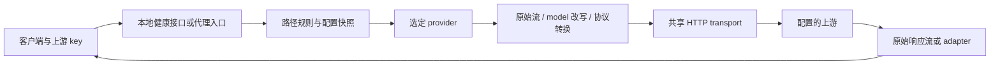

# Transit 架构

本文描述当前服务实现。配置与使用入口见 [README](../README.md)，用户可见契约由功能文档维护。已落地的服务设计不再保留重复 proposal。

## 定位与技术栈

Transit 是一个长期运行的模型 HTTP 反向代理。请求先按路径选择 provider，再执行可选的模型别名、协议转换和 provider 请求 profile，最后由共享 transport 发往固定配置的上游。客户端提供自己的上游认证，Transit 不保存、分配或注入 key。

采用单个 Rust Cargo package、单进程部署：

- Tokio 提供异步运行时、取消、定时和信号。
- Axum 提供代理入口与健康接口；Hyper/hyper-util 负责 HTTP server、上游连接池和流式 body。
- hyper-rustls 使用 webpki 根证书；支持 HTTP/HTTPS 上游，不自动解压、重定向或重放请求。
- serde/TOML 负责严格配置；serde_json 保留对象顺序和数字精度，用于有界改写及 adapter。
- tracing/subscriber/appender 提供结构化日志、非阻塞写入与日滚动，额外 writer 和 janitor 负责 I/O 故障可见性与时间保留期。

选择 Rust 的主要原因是原生二进制交付和对 body 生命周期、背压及取消的控制。模型请求主要受上游延迟影响，语言性能不是补全速度的主要决定因素。当前没有 UI、数据库或 TS 运行时依赖。

## 模块边界

| 模块 | 职责 |
| --- | --- |
| config.rs | 配置类型、完整校验、路径选择和目录解析，不依赖运行中的服务 |
| error.rs | 分类错误及本地 HTTP 错误表示 |
| adapter.rs | Completions/Chat JSON 与 SSE、Qwen FIM 解析，不依赖 listener 或部署环境 |
| proxy.rs | 请求编排、共享上游 client、headers/body、映射、限额、生命周期和错误摘要 |
| logging.rs | 输出、动态过滤、目录锁、writer 健康与过期扫描 |
| server.rs | 有界 HTTP 连接、请求头保护、连接监督与 drain |
| main.rs | CLI、初始化、SIGHUP、后台任务监督和退出 |

协议规则位于配置/adapter 层，网络和文件 I/O 位于运行时模块。当前用模块隔离职责，不增加没有独立需求的 crate 或微服务。

## 三种请求执行路径

1. 原始流：仅修改目标 URL 和传输所需 headers，不解析业务字段或 SSE。没有别名的 provider、非模型改写 endpoint，以及单纯路径改写使用此路径。
2. JSON 改写：模型映射理解顶层 model；显式选择 provider profile 的精确 POST 路由还可设置/删除上游参数。最终未改变字段时发送原 body 字节，响应仍流式透传。
3. 协议转换：特定 POST 路径有界读取请求，转换 prompt/messages 后再应用可选 profile，成功响应执行反向转换；非 2xx 保持原始内容。SSE 只缓冲当前事件。

后两者有意理解部分字段，不能宣称所有请求均逐字节透明。三者复用认证转发、连接池、超时、取消和错误传播。详见 [路由](features/routing.md) 与 [Zed 转换](features/zed_edit.md)。

## 配置与生命周期

启动先校验配置、锁定日志目录并验证写入，再 bind listener。每个代理请求捕获 Arc 快照，之后的 provider、路径、映射和 adapter 均使用同一 generation。SIGHUP 校验新文件后原子替换快照，旧流不受影响。

连接数和在途请求数分别限额。每个接纳请求的生命周期 guard 持有许可，直到响应结束、取消或失败才释放；drop 停止上传并释放上游响应。采用消费驱动的背压，不建立完整响应队列。

上游 client 复用连接。连接、响应头等待、上传/响应 body 空闲超时独立配置，没有生成总时长限制。下游背压暂停 body 轮询时，不另计下游写入截止时间。HTTP/1 请求头读取另有固定 30 秒、64 KiB buffer 和 128 个 header 上限；HTTP/2 header list 为 64 KiB、每连接最多 100 个并发 stream。

每个接纳请求恰有一条最终结果日志。完成表示 body 已交给 HTTP transport，不证明客户端应用已接受预测或保存结果。已知长度的最后一帧须在交出前完成记账，因为 HTTP 层可能不再轮询 EOF。

SIGTERM/SIGINT 停止接纳并 drain，超过 grace 后强制结束在途请求。主任务监督 server、信号和日志维护任务，避免后台退出无人发现；日志 worker guard 保留到退出尾部。

## 观测与边界

日志属于运行诊断，不保存完整请求、用户代码或响应。错误只做有界、脱敏的已知字段提取。队列拥塞或磁盘失败不阻塞模型请求，通过 stderr 与健康字段报告。见 [运维](features/operations.md)。

当前不支持业务审计、token/费用统计、WebSocket/Realtime、CONNECT、多租户、自动重试、fallback、负载均衡或脚本转换。普通 Anthropic Messages 可透传，但不会自动转换为 OpenAI。

## 后续方向

按实际接入问题推进，暂不预建插件平台或审计数据库：

| 方向 | 价值与约束 |
| --- | --- |
| 兼容诊断 | 区分 URL、认证、参数、模板和模型能力，不暴露代码或 key |
| 服务指标 | route 级成功率、首块延迟、取消、限流，不依赖业务内容 |
| 更多 adapter | 按需求增加模板或协议，每个声明输入/输出与语义损失 |
| usage/费用 | 优先使用上游 reported usage，缺失与估算明确区分，旁路不能阻塞转发 |
| 模型发现与能力 | 按需展示实际能力，不把模型统一标成全协议兼容 |
| 内容审计、配额或控制台 | 有需求后再引入，独立定义启用、权限、保留期与费用语义 |

新 observer 使用有界旁路；重试/fallback 必须考虑重复计费和工具执行。新设计讨论放 proposal，实施后更新本架构或对应功能文档。
