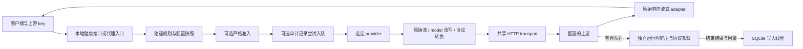

# Transit 架构

本文描述当前服务实现。配置与使用入口见 [README](../README.md)，用户可见契约由功能文档维护。已落地的服务设计不再保留重复 proposal。

## 定位与技术栈

Transit 是一个长期运行的模型 HTTP 反向代理。请求先按路径选择 provider，再执行可选的模型别名、协议转换和 provider 请求 profile，最后由共享 transport 发往固定配置的上游。客户端提供自己的上游认证，Transit 不保存、分配或注入 key。

采用单个 Rust Cargo package、单进程部署：

- Tokio 提供异步运行时、取消、定时和信号。
- Axum 提供代理入口与健康接口；Hyper/hyper-util 负责 HTTP server、上游连接池和流式 body。
- hyper-rustls 使用 webpki 根证书；支持 HTTP/HTTPS 上游，不自动解压、重定向或重放请求。
- serde/TOML 负责严格配置；serde_json 保留对象顺序和数字精度，用于有界改写及 adapter。
- tracing/subscriber/appender 提供结构化日志、非阻塞写入与日滚动，额外 writer 和 janitor 负责 I/O 故障可见性与时间保留期。
- rusqlite 使用 bundled SQLite、WAL 和独立写入线程，按需持久化请求元数据及上游 reported usage。

选择 Rust 的主要原因是原生二进制交付和对 body 生命周期、背压及取消的控制。模型请求主要受上游延迟影响，语言性能不是补全速度的主要决定因素。管理网页以 HTML/CSS/原生 JavaScript 编入二进制，不依赖 Node.js、前端框架或外部资源；SQLite 编入二进制，不需要额外数据库服务。

## 模块边界

| 模块 | 职责 |
| --- | --- |
| config.rs | 配置类型、完整校验、路径选择和目录解析，不依赖运行中的服务 |
| error.rs | 分类错误及本地 HTTP 错误表示 |
| adapter.rs | Completions/Chat JSON 与 SSE、Qwen FIM 解析，不依赖 listener 或部署环境 |
| proxy.rs | 请求编排、共享上游 client、headers/body、映射、限额、生命周期和错误摘要 |
| admission.rs | 可选的协议入口、认证格式、JSON 基本结构与全局准入速率检查 |
| observer.rs | 旁路读取 JSON/SSE 模型、用量、结束状态及业务错误，不修改响应 |
| observation.rs | 独立两线程运行时、有界旁路队列、增量解压、后台请求元数据与响应观察 |
| dashboard.rs + web/ | 独立管理端口、只读 SQLite 查询线程、内嵌统计网页，不调用上游 |
| audit.rs | SQLite schema、私有目录/锁、异步起始记录、结束更新、恢复与保留期 |
| capture.rs | 可选原始 body 抓取、独立有界写入队列、逐请求 JSONL、完整性与存储预算 |
| privacy.rs | 运行日志和审计共用的受限错误脱敏 |
| logging.rs | 输出、动态过滤、目录锁、writer 健康与过期扫描 |
| server.rs | 有界 HTTP 连接、请求头保护、连接监督与 drain |
| main.rs | CLI、初始化、SIGHUP、后台任务监督和退出 |

协议规则位于配置/adapter 层，网络和文件 I/O 位于运行时模块。当前用模块隔离职责，不增加没有独立需求的 crate 或微服务。

## 管理网页边界

`dashboard.rs` 只提供独立管理端口、`/static/*` 内嵌资源和只读统计 API。看板使用相对链接，API 地址以静态模块 URL 推导出的看板根目录解析；反向代理负责剥离外部前缀，服务无需配置或信任转发前缀。`web/static/dashboard.js` 负责页面状态、查询与渲染；`web/static/locales.js` 集中声明语言、地区格式和所有文案，`web/static/i18n.js` 负责语言选择、浏览器偏好、插值和静态属性翻译。页面通过稳定文案键引用配置，不在业务分支中判断中英文。静态 DOM 使用 `data-i18n` 声明，动态视图在语言变化时使用已有数据重绘；可读标签和机器字段分开，原始记录始终保真。

语言是浏览器端偏好，不加入服务的 provider/TOML 配置，也不修改审计数据。新语言在文案表中注册并提供相同键及插值参数即可，切换控件从注册表生成。全部资源遵循同源 CSP；语言逻辑不接触上游认证或代理转发。静态资源随 release 编译更新，新增语言或修改文案需要重建可执行文件。

## 三种请求执行路径

1. 原始流：仅修改目标 URL 和传输所需 headers；关闭 audit/strict 时不额外解析业务字段或 SSE。没有别名的 provider、非模型改写 endpoint，以及单纯路径改写使用此路径。
2. JSON 改写：模型映射理解顶层 model；显式选择 provider profile 的精确 POST 路由还可设置/删除上游参数。最终未改变字段时发送原 body 字节，响应仍流式透传。
3. 协议转换：特定 POST 路径有界读取请求，转换 prompt/messages 后再应用可选 profile，成功响应执行反向转换；非 2xx 保持原始内容。SSE 只缓冲当前事件。

开启 audit 时，普通透传上传只尝试把原始片段放入有界旁路队列，后台提取 model/stream；不因统计缓冲整个上传。strict、模型别名与 adapter 仍按需要读取并校验/改写请求。响应旁路使用独立两线程运行时，按 Content-Encoding 增量解压，并通过有界内容前缀识别 JSON/SSE，再交给协议观察器。未知协议、格式、压缩或观察失败只降低统计完整性，不阻止透传。原始上游字节同时用于转发和可选抓取，统计不改变内容协商或返回头。

后两者有意理解部分字段，不能宣称所有请求均逐字节透明。三者复用认证转发、连接池、超时、取消和错误传播。详见 [路由](features/routing.md) 与 [Zed 转换](features/zed_edit.md)。

## 配置与生命周期

启动先校验配置、锁定日志目录并验证写入；启用 audit 时还需成功打开独占 SQLite 数据库并恢复中断记录，随后 bind listener。每个代理请求捕获 Arc 快照，之后的 provider、路径、映射和 adapter 均使用同一 generation。SIGHUP 校验新文件后原子替换快照，旧流不受影响。

连接数和在途请求数分别限额。每个接纳请求的生命周期 guard 持有许可，直到响应结束、取消或失败才释放；drop 停止上传并释放上游响应。采用消费驱动的背压，不建立完整响应队列。

上游 client 复用连接。连接、响应头等待、上传/响应 body 空闲超时独立配置，没有生成总时长限制。下游背压暂停 body 轮询时，不另计下游写入截止时间。HTTP/1 请求头读取另有固定 30 秒、64 KiB buffer 和 128 个 header 上限；HTTP/2 header list 为 64 KiB、每连接最多 100 个并发 stream。

每个接纳请求恰有一条最终结果日志。完成表示 body 已交给 HTTP transport，不证明客户端应用已接受预测或保存结果。已知长度的最后一帧须在交出前完成记账，因为 HTTP 层可能不再轮询 EOF。

SIGTERM/SIGINT 停止接纳并 drain，默认 grace 为 180 秒，超过后强制结束在途请求。主任务监督 server、信号和日志维护任务，避免后台退出无人发现；抓取和审计线程在请求结束后刷新退出，日志 worker guard 保留到退出尾部。

## 观测与边界

日志属于运行诊断，不保存完整请求、用户代码或响应。错误只做有界、脱敏的已知字段提取。队列拥塞或磁盘失败不阻塞模型请求，通过 stderr 与健康字段报告。见 [运维](features/operations.md)。

SQLite 审计独立于运行日志：起始行非阻塞入队，结束更新使用预留队列槽，不等待磁盘确认。观察结果在后台合入终结元数据再入库；运行日志及抓取的 request_finished 表示转发结果，随后独立 observation_result 可能补充业务失败。队列/资源/写入故障通过日志和健康计数报告，服务继续转发且 ready 不因此失败。统计采用最终一致、尽力记录语义；强杀或过载时可能缺记录。正常退出先等待观察任务（最多额外 10 秒），再刷新 SQLite 队列并 checkpoint；已有 in_progress 在下次启动恢复为 interrupted。

可选 capture 独立于日志及 SQLite，保存客户端原始请求、转换前上游原始响应与少量白名单头，用于私有排障。body 按片段交给有界非阻塞队列，由专用线程 Base64 编码并写入逐请求 JSONL；大小、队列或磁盘限制只降低抓取完整性，不改变转发。每个请求保留自己的抓取开关和 body 上限快照；目录需重启，其他抓取设置可热加载，存储预算与保留期作用于整个目录。

当前不支持内容检索审计、费用估算、WebSocket/Realtime、CONNECT、多租户、自动重试、fallback、负载均衡或脚本转换。普通 Anthropic Messages 可透传，但不会自动转换为 OpenAI。

## 后续方向

按实际接入问题推进，暂不预建插件平台或管理控制台：

| 方向 | 价值与约束 |
| --- | --- |
| 兼容诊断 | 区分 URL、认证、参数、模板和模型能力，不暴露代码或 key |
| 服务指标 | route 级成功率、首块延迟、取消、限流，不依赖业务内容 |
| 更多 adapter | 按需求增加模板或协议，每个声明输入/输出与语义损失 |
| 费用与用量分析 | 基于已有 reported usage 统计，缓存/推理口径明确区分；定价版本和缺失记录单独处理 |
| 模型发现与能力 | 按需展示实际能力，不把模型统一标成全协议兼容 |
| 内容审计、配额或控制台 | 有需求后再引入，独立定义启用、权限、保留期与费用语义 |

新 observer 使用有界旁路；重试/fallback 必须考虑重复计费和工具执行。新设计讨论放 proposal，实施后更新本架构或对应功能文档。
